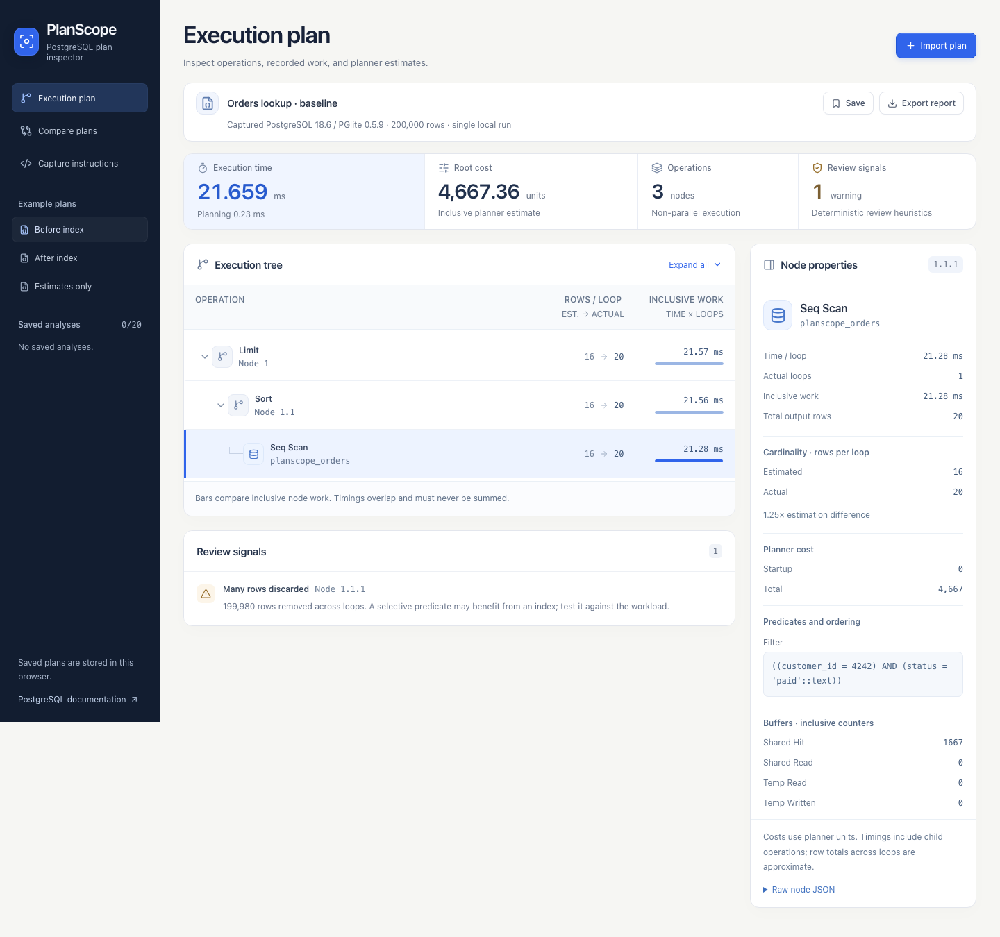
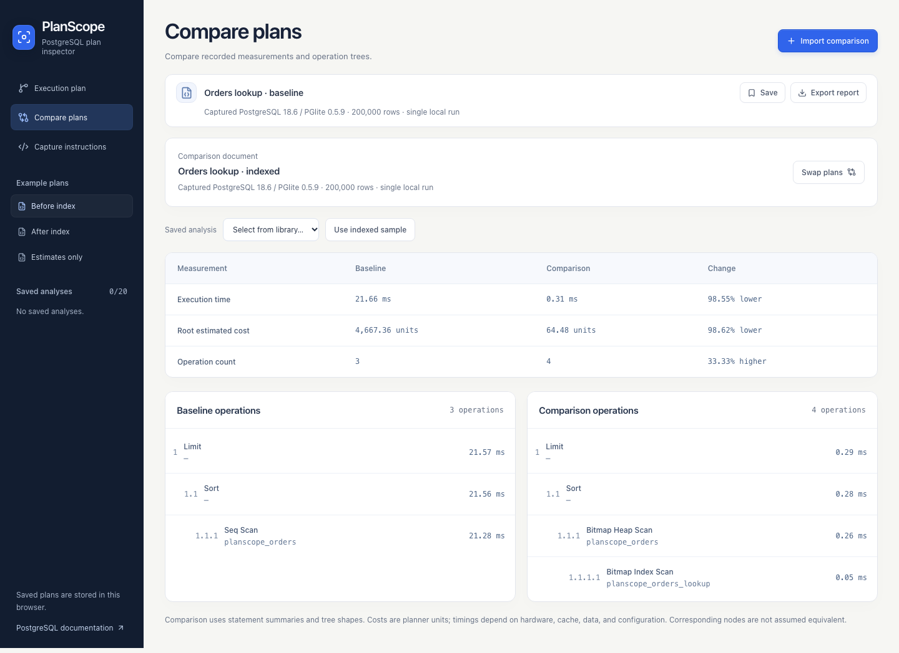
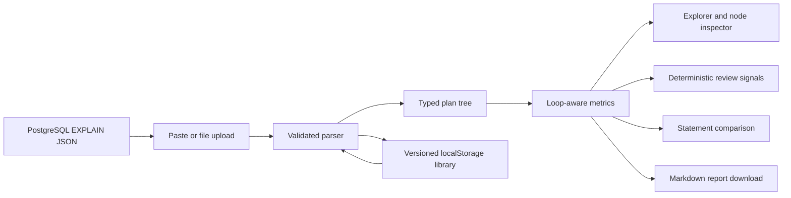

# PlanScope

**Understand what PostgreSQL is doing with your query.**

PlanScope turns PostgreSQL `EXPLAIN` JSON into a compact execution tree, review signals, and a before/after comparison. It helps answer a practical question: _did that database change actually improve this query?_

Built with React, TypeScript, and Vite, with locally bundled Inter typography. Analysis happens in the browser, with no database credentials, AI service, or backend required.



## What it does

- Paste or upload PostgreSQL JSON and get actionable parse errors.
- Follow a collapsible execution tree and inspect any operation’s predicates, costs, rows, loops, buffers, and original JSON.
- Compare estimated and actual **rows per loop**, including zero-row and never-executed operations.
- Inspect deterministic signals for large cardinality differences, selective sequential scans, disk sorts, repeated operations, and parallel work.
- Compare statement execution times, root planner costs, node counts, and tree shapes.
- Save up to 20 analyses in browser-local storage, reload them, or delete them.
- Export a Markdown report with provenance, node measurements, signals, comparisons, and interpretation limits.
- Work with ordinary `EXPLAIN`, `EXPLAIN ANALYZE`, and `ANALYZE` with `TIMING OFF`.
- Brief entrances on navigation, node selection, and dialogs; reduced-motion preferences disable movement. Selecting a node keeps the main surface steady and preserves keyboard focus.

## Run locally

Requires Node.js 24 or newer.

```bash
npm ci
npm run dev
```

Open **http://127.0.0.1:5173**. The dev server binds to localhost. No environment variables or database setup are needed to use the included plans.

```bash
npm run build        # Type-check and produce dist/
npm run preview      # Serve the production build locally
```

## A real demo

The default example is an orders lookup over **200,000 deterministic rows**. Before indexing, PostgreSQL scans all orders and discards 199,980 rows. A composite index changes the plan to a bitmap index/heap scan. The planner retains a small in-memory sort; PlanScope displays that actual behavior.

The checked-in plans were captured on PostgreSQL **18.6**, compiled to WebAssembly through **PGlite 0.5.9**. Their execution times are **21.659 ms before** and **0.313 ms after**. These are single local observations, not a production benchmark or a promised speedup. Hardware, engine, data, cache state, and configuration all affect timing.

1. Open the baseline and select **Seq Scan**. Notice the filter and **199,980 rows discarded** signal.
2. Select **Sort** to see ordering, inclusive timing, and raw node properties.
3. Open **Compare plans**. The default comparison contains the indexed capture. Inspect the added bitmap index scan and the execution delta.
4. Select **Estimates only** to see how missing measurements are represented rather than invented. This example is derived from the baseline by removing observed measurements.
5. Import your own output, save it, reload the page, and export the report.



### Reproduce the experiment

A real PostgreSQL server is optional. The bundled script runs the same SQL in an in-memory PGlite database and verifies that the index preserves all 20 returned rows:

```bash
npm run experiment
```

It writes new `before.json`, `after.json`, and provenance to **`demo/generated/`**, leaving the checked-in captures intact. Import the generated plans to inspect your own run. This script is a developer dependency; the browser app does not ship or run PGlite.

For a PostgreSQL server, use an empty disposable database:

```bash
psql "$DATABASE_URL" -f demo/setup.sql
```

Copy only each JSON array from the output into PlanScope. `setup.sql` creates a sample table, inserts data, captures the baseline, adds the index, and captures the indexed plan. It is intended for an empty test database and is not idempotent. Full capture metadata is in [demo/provenance.json](demo/provenance.json).

For your own read-only query:

```sql
EXPLAIN (ANALYZE, BUFFERS, FORMAT JSON)
SELECT ...;
```

`ANALYZE` executes the SQL in your database. PlanScope itself only reads JSON. Use `EXPLAIN (FORMAT JSON)` if you want planner estimates without execution.

## Architecture



The application has one input boundary: `parsePlan` validates JSON before it becomes app state. It accepts the standard single-element PostgreSQL array, the statement wrapper, or a bare node. Input is limited to 2 MB, 1,000 nodes, and 64 nesting levels. Required fields, numeric ranges, loop integers, and cumulative overflow are validated; unknown properties are preserved for inspection.

| Area         | Files                                    | Responsibility                                                       |
| ------------ | ---------------------------------------- | -------------------------------------------------------------------- |
| Plan model   | `src/lib/plan.ts`                        | Parsing, metrics, heuristics, comparison, report generation          |
| Persistence  | `src/lib/storage.ts`                     | Versioned local library, schema checks, quota handling               |
| UI           | `src/App.tsx`, `src/components/`         | Import, exploration, comparison, capture guide                       |
| Captures     | `demo/`                                  | Original PostgreSQL output, SQL, provenance, reproducible experiment |
| Verification | `src/lib/*.test.ts`, `tests/app.spec.ts` | Numeric/structural behavior and full browser flows                   |

### Decisions and tradeoffs

**Local processing.** Query plans may expose table names and predicates. Keeping processing in the browser avoids a server trust boundary and makes a demo usable immediately. The tradeoff is device-local history without accounts, collaboration, or synchronization. Saved inputs are plain text in localStorage; deleting an analysis removes its persisted copy.

**Deterministic signals.** Heuristics are small, inspectable functions with known thresholds, rather than generated diagnoses. A signal suggests what to investigate; it does not guarantee that an index or memory setting is the right fix.

**Statement-level comparisons.** A new index can radically change the tree. PlanScope compares statement summaries and displays both shapes without pretending every baseline node has an equivalent node in the new plan. It does not prove query equivalence; the bundled experiment separately verifies its results.

**Inclusive measurements.** PostgreSQL timings and costs include descendant work. Node actual times and rows are per-loop averages. PlanScope multiplies them by actual loops to show inclusive work and approximate aggregate output, while cardinality error compares per-loop rows. It deliberately avoids computed self time and a misleading “percentage of execution time.” Parallel workers can overlap, so node work is not wall-clock duration. Buffer counters are already accumulated and are never multiplied by loops or summed across the tree.

**Small dependency surface.** The UI uses React and Lucide icons, native dialogs/downloads, and ordinary CSS. Inter is bundled locally through Fontsource; its [OFL license](docs/INTER-LICENSE.txt) is included. PGlite is used only for the reproducible developer experiment. No database engine is included in the production client bundle.

## Verification

```bash
npm run test
npm run build
npx playwright install chromium
npm run test:e2e
npm run experiment
```

Verified locally on Node.js 24.21.0:

- **36 unit tests**: captured-plan parsing; wrapper/bare-node input; loops and zero loops; ordinary EXPLAIN and TIMING OFF; zero-row cardinality differences; malformed, oversized, deep, and numerically overflowing input; heuristics; comparison; report content; storage recovery and quota errors.
- **10 Chromium browser stories**: tree selection/collapse/expand; saving and reload; invalid input and import; report download/content; estimates-only mode; real-plan comparison/import/swap; file upload; SQL download; Escape dismissal; mobile layout without page overflow; zero-time ANALYZE work bars; planner-cost labels for ordinary EXPLAIN and TIMING OFF; reduced-motion usability; focus preservation and steady main content during animated inspection.
- **Production build**: strict TypeScript check and Vite build.
- **Reproducible database experiment**: original and indexed SQL return identical rows.
- **Browser observation**: no uncaught page errors, no external network requests during the verified flows, and a 390 px mobile page with no document overflow.

The GitHub Actions workflow runs clean installs, the unit suite, build, actual database experiment, and Chromium stories on Node 24. Failed browser traces are uploaded as artifacts. Screenshots in `docs/` were captured from the working local app after fonts loaded and entrance animations settled. A [short interaction recording](docs/motion-demo.webm) shows node selection, comparison, capture instructions, and the import dialog.

## Limits

PlanScope supports PostgreSQL JSON for one statement at a time. It does not accept text, YAML, MySQL, or other engines. Worker details and engine-specific fields remain available in raw node JSON; the analyzer does not deeply model worker timelines, JIT, trigger timings, or every PostgreSQL operator.

Planner costs are arbitrary planner units, not milliseconds. Estimated rows generally assume full completion, so a `LIMIT` or another early-stopping parent can make the estimate comparison look worse. PostgreSQL rounds per-loop averages, making aggregate row counts approximate. A plan can have observed rows without node timing (`TIMING OFF`), or without statement timing; those measurements remain absent in the UI and report.

No heuristic triggering does not prove a query is optimal. A faster single run does not prove a production improvement. Repeat measurements on comparable data, configuration, and cache conditions; verify equivalent query results. Saving is limited by browser storage quotas, and analyses are not shared between devices or browser profiles.

## License

[MIT](LICENSE) · Mert Kanıbir
